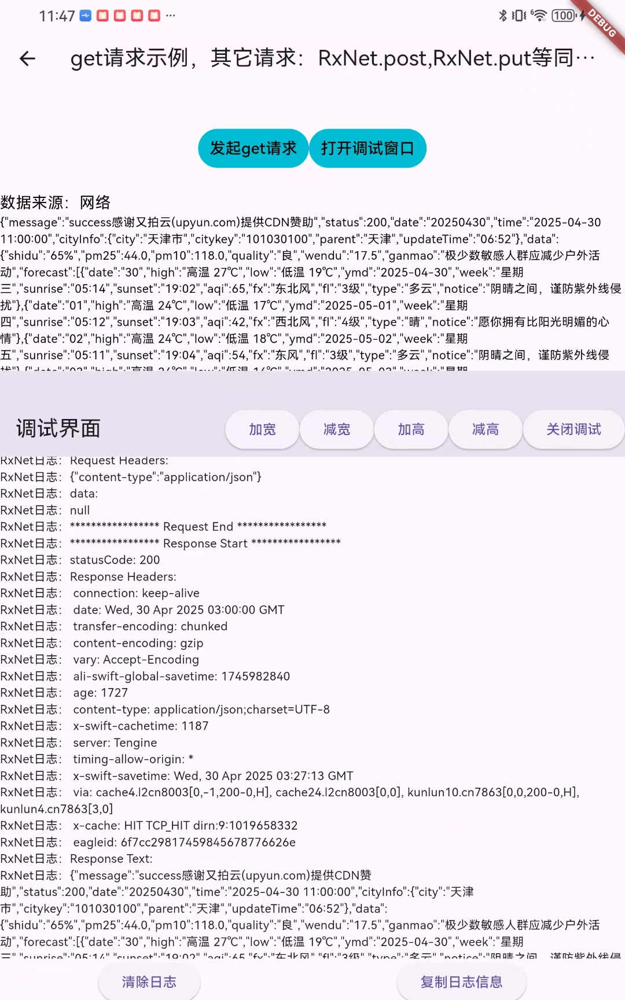
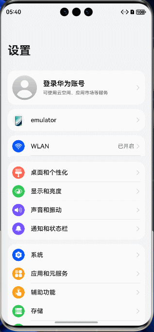

# RxNet

[](https://pub.dev/packages/rxnet_plus)
[](https://github.com/ZhengZaiHong/rxnet)
[](LICENSE)

Language: [English](README.md) | 简体中文

RxNet：极简易用、强大、原生风格的 Flutter 网络通信框架

RxNet 是专为 Flutter 构建的跨平台网络请求工具，贴合原生开发习惯，几乎零学习成本即可上手，支持丰富的功能组合，助你构建高性能、可维护的应用程序。

---
[使用说明文档](doc/USAGE_GUIDE.md)

**在线 Web 示例：** [zhengzaihong.github.io/rxnet](https://zhengzaihong.github.io/rxnet/)


## 最新版本：0.7.2

请使用 **rxnet_plus ^0.7.2**（或更高版本）。

```yaml
dependencies:
  rxnet_plus: ^0.7.2
```

**0.7.2 新特性：**

- **全平台条件导入** - IO（`dart:io`）与 Web 分支均可打包；`IOClient` / `IOHttpClientAdapter` 仅在 IO 平台导出。
- **安全默认值** - 日志默认关闭；Header、Body、PII 字段与 URL query token 默认脱敏。
- **生命周期修复** - 新增 `RxNet.dispose()`、幂等初始化、取消回调清理与日志/拦截器缓存上限。
- **行为修复** - `init` 正确使用 `config.adapter`；`setEnv` 影响真实请求；请求缓存接入淘汰策略；重试与 `request()` 返回最终结果。
- **现代示例** - Material 3 响应式 Playground，覆盖全部方法、缓存、重试、超时、取消、并发、Multipart 与日志。

> ⚠️ 0.7.2 虽是补丁版本，但包含行为变更。升级前请阅读
> [迁移指南_0.7.2.md](迁移指南_0.7.2.md)。


---

## 目录

- [快速开始](#快速开始)
- [RxNetConfig](#rxnetconfig)
- [缓存淘汰](#缓存淘汰)
- [重试策略](#重试策略)
- [AdapterBaseOptions](#adapterbaseoptions)
- [适配器选择](#适配器选择)
- [请求示例](#请求示例)
- [内置拦截器](#内置拦截器)
- [并发请求](#并发请求)
- [上传与下载](#上传与下载)
- [证书校验](#证书校验)
- [迁移指南：0.7.1 → 0.7.2](#迁移指南071--072)


---

## 依赖说明

当前版本同时内置两套适配器，以下依赖均为硬依赖，无法通过配置剔除：

- `dio` — 默认适配器（`DioAdapter`）
- `http` — 轻量适配器（`HttpAdapter`）
- `sembast` / `sembast_web` — 持久化缓存
- `path_provider` — 缓存目录解析
- `web` — 浏览器下载辅助

如果对包体敏感，可将适配器拆分为联邦包，或实现自定义适配器并在 fork 中依赖。
`rxnet_lib.dart` 目前会同时导出两套适配器。

---

## 快速开始

### 方式一：RxNetConfig（推荐）

```dart
await RxNet.init(config: RxNetConfig(
  baseUrl: "https://api.example.com",
  cacheMode: CacheMode.CACHE_EMPTY_OR_EXPIRED_THEN_REQUEST,
  cacheInvalidationTime: 24 * 60 * 60 * 1000,
  cacheMaxSize: 500,
  cacheEvictionPolicy: CacheEvictionPolicy.lru,
  adapterBaseOptions: AdapterBaseOptions(
    connectTimeout: Duration(seconds: 10),
    sendTimeout:  Duration(seconds: 10),
    receiveTimeout: Duration(seconds: 30),
  ),
  interceptors: [
    RxNetLogAdapterInterceptor(),
  ],
));
```

### 方式二：Builder 模式

```dart
await RxNet.init(config: RxNetConfig.builder()
  .baseUrl("https://api.example.com")
  .cacheMode(CacheMode.CACHE_EMPTY_OR_EXPIRED_THEN_REQUEST)
  .cacheInvalidationTime(24 * 60 * 60 * 1000)
  .cacheMaxSize(500)
  .cacheEvictionPolicy(CacheEvictionPolicy.lru)
  .baseOptions(AdapterBaseOptions(
    connectTimeout: Duration(seconds: 10),
    sendTimeout:  Duration(seconds: 10),
    receiveTimeout: Duration(seconds: 30),
  ))
  .addInterceptor(RxNetLogAdapterInterceptor())
  .build());
```

---

## RxNetConfig

`RxNetConfig` 是推荐的 RxNet 配置方式，提供清晰、类型安全的配置对象，支持 Builder 模式。

### 所有配置选项

```dart
final config = RxNetConfig(
  baseUrl: "https://api.example.com",          // 必填
  adapter: DioAdapter(),                        // 可选，默认 DioAdapter
  adapterBaseOptions: AdapterBaseOptions(       // 可选，全局请求默认配置
    connectTimeout: Duration(seconds: 10),
    sendTimeout:  Duration(seconds: 10),
    receiveTimeout: Duration(seconds: 30),
    headers: {'Authorization': 'Bearer token'},
  ),
  cacheMode: CacheMode.CACHE_EMPTY_OR_EXPIRED_THEN_REQUEST,
  cacheInvalidationTime: 60 * 1000,            // 1 分钟
  cacheMaxSize: 500,                           // 最大 500 条
  cacheEvictionPolicy: CacheEvictionPolicy.lru, // LRU 淘汰
  interceptors: [RxNetLogAdapterInterceptor()],
  cachePath: '/path/to/cache',
  cacheName: 'network_cache',
  databaseName: 'rxnet_cache.db',
  ignoreCacheKeys: ['token'],
  baseUrlEnv: {'dev': 'https://dev.api.com', 'prod': 'https://api.com'},
  baseCheckNet: myCheckNetFunction,
);
```

### copyWith

```dart
final updatedConfig = config.copyWith(
  baseUrl: "https://new-api.example.com",
  cacheMaxSize: 1000,
);
```

---

## 缓存淘汰

### 缓存淘汰策略

```dart
await RxNet.init(config: RxNetConfig(
  baseUrl: "https://api.example.com",
  cacheMaxSize: 200,
  cacheEvictionPolicy: CacheEvictionPolicy.lru,
));
```

| 策略 | 行为 |
|------|----------|
| `CacheEvictionPolicy.none` | 不淘汰（默认，向后兼容） |
| `CacheEvictionPolicy.lru` | 淘汰最久未访问的条目 |
| `CacheEvictionPolicy.lfu` | 淘汰访问次数最少的条目 |
| `CacheEvictionPolicy.fifo` | 淘汰最早创建的条目 |


### 缓存管理

```dart
final cache = RxNet.I.cacheManager;

// 保存/读取网络缓存
await cache.saveNetworkCache(path: '/api/data', params: {'page': 1}, responseData: {...});
final data = await cache.readNetworkCache(path: '/api/data', params: {'page': 1});

// 保存/读取键值缓存
await cache.put('user_token', 'abc123');
final token = await cache.get<String>('user_token');

// 清除缓存
await cache.clearAll();
await cache.clearByPrefix('/api/users');
await cache.clearByPattern(r'^/api/v\d+/');

// 查询缓存
final size = await cache.getCacheSize();
final keys = await cache.getAllKeys();
```

---

## 重试策略

### 固定间隔（默认，向后兼容）

```dart
RxNet.get()
  .setPath("/api/data")
  .setRetryCount(3, interval: Duration(seconds: 2))
  .request();
```

### 高级 RetryPolicy

```dart
// 指数退避
RxNet.get()
  .setPath("/api/data")
  .setRetryPolicy(RetryPolicy.exponentialBackoff(
    maxRetries: 3,
    baseInterval: Duration(seconds: 1),
    maxInterval: Duration(seconds: 30),
  ))
  .request();

// 指数退避 + 随机抖动（推荐用于分布式系统）
RxNet.get()
  .setPath("/api/data")
  .setRetryPolicy(RetryPolicy.exponentialBackoffWithJitter(
    maxRetries: 5,
    baseInterval: Duration(seconds: 1),
    maxInterval: Duration(seconds: 30),
  ))
  .request();
```

| 策略 | 第 1 次 | 第 2 次 | 第 3 次 | 适用场景 |
|------|---------|---------|---------|----------|
| `fixed` | 1s | 1s | 1s | 简单场景 |
| `exponentialBackoff` | 1s | 2s | 4s | 服务器过载恢复 |
| `exponentialBackoffWithJitter` | ~0.5s | ~1.5s | ~3s | 分布式系统 |

---

## AdapterBaseOptions

设置适用于所有适配器的全局请求默认配置：

```dart
await RxNet.init(config: RxNetConfig(
  baseUrl: "https://api.example.com",
  adapterBaseOptions: AdapterBaseOptions(
    connectTimeout: Duration(seconds: 10),
    sendTimeout:  Duration(seconds: 10),
    receiveTimeout: Duration(seconds: 30),
    sendTimeout: Duration(seconds: 30),
    headers: {'Authorization': 'Bearer token'},
    contentType: 'application/json',
    responseType: ResponseType.json,
    followRedirects: true,
    maxRedirects: 5,
    receiveDataWhenStatusError: true,
    persistentConnection: true,
  ),
));
```

请求级参数始终优先于全局默认值

---

## 适配器选择

| 适配器 | 包 | 功能 | 取消 | 最适合 |
|--------|-----|------|------|--------|
| **DioAdapter** | `dio: ^5.8.0+1` | 所有功能、拦截器 | 真正取消（中止连接） | 生产应用（默认） |
| **HttpAdapter** | `http: ^1.2.0` | 基础 HTTP、拦截器、multipart、流式 | 伪取消（标记已取消） | 轻量级应用 |
| **MockAdapter** | 内置 | 测试、无网络 | 模拟 | 单元/集成测试 |

**默认行为：** 未指定适配器时自动使用 DioAdapter。

### 多实例

```dart
final mainApi = RxNet.create();
await mainApi.initNet(config: RxNetConfig(baseUrl: "https://api.main.com", adapter: DioAdapter()));

final analyticsApi = RxNet.create();
await analyticsApi.initNet(config: RxNetConfig(baseUrl: "https://analytics.example.com", adapter: HttpAdapter()));
```

---

## 请求示例

### 支持的请求方式

`get`、`post`、`delete`、`put`、`patch`、`head`、`options`

### 缓存模式

```dart
enum CacheMode {
  ONLY_REQUEST,                        // 不缓存，每次请求网络
  ONLY_CACHE,                          // 仅使用缓存，不请求网络
  REQUEST_FAILED_READ_CACHE,           // 先请求网络，失败后读取缓存
  FIRST_USE_CACHE_THEN_REQUEST,        // 先使用缓存，再请求网络
  CACHE_EMPTY_OR_EXPIRED_THEN_REQUEST, // 缓存为空或过期时才请求网络
}
```

### 1. 回调模式

```dart
RxNet.get<WeatherInfo>()
  .setPath('/api/weather/city/{id}')
  .setPathParam("id", "101030100")
  .setCacheMode(CacheMode.CACHE_EMPTY_OR_EXPIRED_THEN_REQUEST)
  .setJsonConvert(WeatherInfo.fromJson)
  .setRetryPolicy(RetryPolicy.exponentialBackoff(maxRetries: 3))
  .execute(
    success: (data, source) {
      setState(() { weather = data; });
    },
    failure: (e) {
      setState(() { error = e.toString(); });
    },
    completed: () { /* 始终执行 */ },
  );
```

### 2. async/await 模式

```dart
final result = await RxNet.get<WeatherInfo>()
  .setPath('/api/weather/city/{id}')
  .setPathParam("id", "101030100")
  .setJsonConvert(WeatherInfo.fromJson)
  .request();

if (result.isSuccess) {
  print(result.value);
}
```

### 3. Stream 流式模式

```dart
StreamSubscription? _subscription;

_subscription = RxNet.get()
  .setPath('/api/weather/city/{id}')
  .setPathParam("id", "101030100")
  .setLoop(true, interval: const Duration(seconds: 5))
  .executeStream()
  .listen((result) {
    if (result.isSuccess) { setState(() { weather = result.value; }); }
  });

// 不忘记在 dispose() 中取消
@override
void dispose() { _subscription?.cancel(); super.dispose(); }
```

---

## 内置拦截器

### TokenRefreshInterceptor

```dart
TokenRefreshInterceptor(
  tokenProvider: () async { ... },
  isUnauthorized: (error, request) => error.statusCode == 401,
  onRequestUpdated: (request, newToken) {
    return request.copyWith(headers: {...request.headers, 'Authorization': 'Bearer $newToken'});
  },
  onTokenRefreshed: (token) => currentToken = token,
);
```

### DeduplicateInterceptor

```dart
DeduplicateInterceptor(duration: Duration(milliseconds: 500))
```

### ThrottleInterceptor

```dart
ThrottleInterceptor(duration: Duration(seconds: 1))
```

---

## 并发请求

### async/await 请求（推荐）

```dart
final (weather, user) = await (
  RxNet.get<Weather>().setPath('/weather').request(),
  RxNet.get<User>().setPath('/user').request(),
).wait;
```

### 回调式请求（zipRequest）

```dart
final results = await RxNet.zipRequest([
  ZipRequest<Weather>(request: fetchWeather, tag: 'weather'),
  ZipRequest<User>(request: fetchUser, tag: 'user'),
]);
final weather = results.getRequestByTag<Weather>('weather');
```

`fetchWeather` / `fetchUser` 必须是回调式函数，接收
`{success, failure, completed}` 命名参数。

---

## 上传与下载

### 按平台的建议用法

| 能力 | IO（Android / iOS / 桌面等） | Web |
|---|---|---|
| `download` / `downloadFile` | 下载到真实本地路径（`savePath`） | 优先使用 `Downloader.downloadFile(url: ...)`。使用 **DioAdapter** 时，`savePath` 仅作为浏览器的**建议文件名**（实际保存位置由浏览器决定）。**HttpAdapter** 在 Web 上下载不支持。 |
| `breakPointDownload` | 支持（依赖本地文件读写） | 不支持（无本地文件系统） |
| `upload` / `uploadFile` | 可使用 `MultipartFile.fromFile` / 路径类 API | 使用 `MultipartFile.fromBytes` / `fromStream`（可配合 `file_picker`）。**不要**使用 `fromFile` / `fromPath` 或直接传 `dart:io File`。 |
| `breakPointUpload` | 支持 | 不支持（无本地文件系统） |

Web 请求仍受浏览器限制（CORS、混合内容等）。

### IO 示例

```dart
// 下载到本地路径
await RxNet.get().setPath("https://example.com/file.zip")
  .downloadFile(savePath: "${appDocPath}/file.zip");

// 断点下载
RxNet.get().setPath("https://example.com/large-file.zip")
  .breakPointDownload(savePath: "...", onReceiveProgress: (len, total) {});

// 从本地路径上传
final file = await MultipartFile.fromFile("/path/to/file.jpg");
await RxNet.post()
  .setPath("/api/upload")
  .setBodyParam("file", file)
  .asFormData()
  .uploadFile();

// 断点上传
RxNet.post().setPath("/api/upload")
  .breakPointUpload(filePath: "/path/to/file.jpg", onSendProgress: (len, total) {});
```

### Web 示例

```dart
// 推荐：触发浏览器下载
Downloader.downloadFile(url: "https://example.com/file.zip");

// 上传：先拿到 bytes，再构造 MultipartFile（不要用 fromFile / 本地路径）
final bytes = selectedFileBytes; // 例如来自 file_picker
final file = MultipartFile.fromBytes(bytes, filename: "file.jpg");
await RxNet.post()
  .setPath("/api/upload")
  .setBodyParam("file", file)
  .asFormData()
  .uploadFile();
```

---


## 证书校验

#### 使用 DioAdapter（dio 包方式）

> ⚠️ `badCertificateCallback` 会在正常证书校验失败后触发。
> **生产环境绝不能直接 `return true`**，必须校验固定的 SHA-256 证书指纹。

```dart
import 'dart:io';
import 'package:crypto/crypto.dart';
import 'package:dio/io.dart';

const trustedFingerprint = 'YOUR_CERT_SHA256_FINGERPRINT';

adapter.dio.httpClientAdapter = IOHttpClientAdapter(
  createHttpClient: () {
    final client = HttpClient();
    client.badCertificateCallback = (cert, host, port) {
      final fingerprint = sha256.convert(cert.der).toString();
      return fingerprint == trustedFingerprint;
    };
    return client;
  },
);
```

#### 使用 HttpAdapter（http 包方式）


```dart
import 'dart:io';
import 'package:crypto/crypto.dart';
import 'package:http/io_client.dart';

// 创建带证书校验的自定义 HTTP 客户端
// 生产环境绝不能绕过证书校验。
IOClient createPinnedClient() {
  final HttpClient httpClient = HttpClient();
  httpClient.badCertificateCallback = (X509Certificate cert, String host, int port) {
    final fingerprint = sha256.convert(cert.der).toString();
    return fingerprint == 'YOUR_CERT_SHA256_FINGERPRINT';
  };
  return IOClient(httpClient);
}

// 使用自定义客户端创建 HttpAdapter
final httpAdapter = HttpAdapter(client: createPinnedClient());

// 使用配置好的适配器初始化 RxNet
await RxNet.init(
  config: RxNetConfig(
    baseUrl: 'https://your-api.com',
    adapter: httpAdapter,
  ),
);
```

## 迁移指南：0.7.1 → 0.7.2

0.7.2 包含行为变更，升级前请阅读完整
[迁移指南](迁移指南_0.7.2.md)。

- `isDebug` 默认关闭，仅在 debug 包显式开启。
- `request()` 返回缓存/网络/重试的最终结果；缓存优先 UI 请使用
  `executeStream()`。
- POST/PATCH 默认不自动重试；仅在接口可安全重复时开启
  `RetryPolicy.retryOnNonIdempotent`。
- 路径缓存键改为哈希；旧路径缓存会一次性失效。
- 拦截器支持异步并会被 await；`TokenRefreshInterceptor` 通过
  `ErrorInterceptorHandler.retry` 真正重试。
- `IOClient` / `IOHttpClientAdapter` 仅在 IO 平台导出。

```dart
await RxNet.init(
  config: RxNetConfig(
    baseUrl: 'https://api.example.com',
    isDebug: kDebugMode,
  ),
);
```


---

## 调试窗口

```dart
RxNet.showDebugWindow(context);
```



## HarmonyOS 支持



