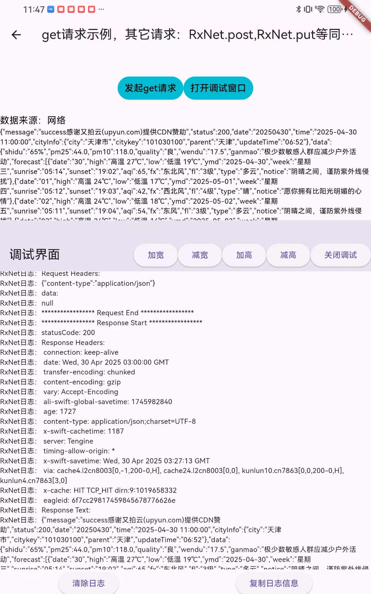
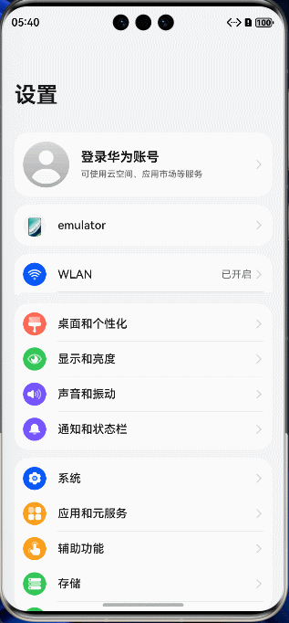

# RxNet

[](https://pub.dev/packages/rxnet_plus)
[](https://github.com/ZhengZaiHong/rxnet)
[](LICENSE)

Language: English | [简体中文](README-ZH.md)

RxNet: Extremely Easy-to-Use, Powerful, Native-Style Flutter Network Communication Framework

RxNet is a cross-platform network request tool specially built for Flutter. It conforms to native development habits, can be started with almost zero learning cost, and supports rich function combinations to help you build high-performance, maintainable applications.

---
[instructions for use document](doc/USAGE_GUIDE.md)

**Live Web demo:** [zhengzaihong.github.io/rxnet](https://zhengzaihong.github.io/rxnet/)

## Latest: 0.7.2

```yaml
dependencies:
  rxnet_plus: ^0.7.2
```

**New in 0.7.2:**

- **Full-platform imports** - IO (`dart:io`) and Web conditional branches are both buildable; `IOClient` / `IOHttpClientAdapter` are exported only on IO.
- **Secure defaults** - debug logging is off by default; headers, body, PII keys and URL query tokens are redacted.
- **Correct lifecycle** - `RxNet.dispose()`, idempotent init, request cancellation cleanup and bounded log/interceptor caches.
- **Behavior fixes** - `init` honors `config.adapter`, `setEnv` affects real requests, cache eviction works for request caches, and retries/`request()` return the final result.
- **Modern example** - Responsive Material 3 Playground covering all HTTP methods, caching, retry, timeout, cancellation, concurrency, multipart and logs.

> ⚠️ 0.7.2 contains behavior changes despite the patch version. See
> [MIGRATION_GUIDE_0.7.2.md](MIGRATION_GUIDE_0.7.2.md) before upgrading.


## Table of Contents

- [Quick Start](#quick-start)
- [RxNetConfig](#rxnetconfig)
- [Cache Eviction](#cache-eviction)
- [Retry Policy](#retry-policy)
- [AdapterBaseOptions](#adapterbaseoptions)
- [Adapter Selection](#adapter-selection)
- [Request Examples](#request-examples)
- [Built-in Interceptors](#built-in-interceptors)
- [Concurrent Requests](#concurrent-requests)
- [Upload & Download](#upload--download)
- [Certificate Validation](#certificate-validation)
- [Migration from 0.7.1 to 0.7.2](#migration-from-071-to-072)


---

## Quick Start

### Option 1: RxNetConfig (Recommended)

```dart
await RxNet.init(config: RxNetConfig(
  baseUrl: "https://api.example.com",
  cacheMode: CacheMode.CACHE_EMPTY_OR_EXPIRED_THEN_REQUEST,
  cacheInvalidationTime: 24 * 60 * 60 * 1000,
  cacheMaxSize: 500,
  cacheEvictionPolicy: CacheEvictionPolicy.lru,
  adapterBaseOptions: AdapterBaseOptions(
    connectTimeout: Duration(seconds: 10),
    sendTimeout:  Duration(seconds: 10),
    receiveTimeout: Duration(seconds: 30),
  ),
  interceptors: [
    RxNetLogAdapterInterceptor(),
  ],
));
```

### Option 2: Builder Pattern

```dart
await RxNet.init(config: RxNetConfig.builder()
  .baseUrl("https://api.example.com")
  .cacheMode(CacheMode.CACHE_EMPTY_OR_EXPIRED_THEN_REQUEST)
  .cacheInvalidationTime(24 * 60 * 60 * 1000)
  .cacheMaxSize(500)
  .cacheEvictionPolicy(CacheEvictionPolicy.lru)
  .baseOptions(AdapterBaseOptions(
    connectTimeout: Duration(seconds: 10),
    sendTimeout:  Duration(seconds: 10),
    receiveTimeout: Duration(seconds: 30),
    
  ))
  .addInterceptor(RxNetLogAdapterInterceptor())
  .build());
```

---

## RxNetConfig

`RxNetConfig` is the recommended way to configure RxNet. It provides a clean, type-safe configuration object with Builder pattern support.

### All Configuration Options

```dart
final config = RxNetConfig(
  baseUrl: "https://api.example.com",          // Required
  adapter: DioAdapter(),                        // Optional, defaults to DioAdapter
  adapterBaseOptions: AdapterBaseOptions(       // Optional, global request defaults
    connectTimeout: Duration(seconds: 10),
    receiveTimeout: Duration(seconds: 30),
    sendTimeout:  Duration(seconds: 10),
    headers: {'Authorization': 'Bearer token'},
  ),
  cacheMode: CacheMode.CACHE_EMPTY_OR_EXPIRED_THEN_REQUEST,
  cacheInvalidationTime: 60 * 1000,            // 1 minute
  cacheMaxSize: 500,                           // Max 500 entries
  cacheEvictionPolicy: CacheEvictionPolicy.lru, // LRU eviction
  interceptors: [RxNetLogAdapterInterceptor()],
  cachePath: '/path/to/cache',
  cacheName: 'network_cache',
  databaseName: 'rxnet_cache.db',
  ignoreCacheKeys: ['token'],
  baseUrlEnv: {'dev': 'https://dev.api.com', 'prod': 'https://api.com'},
  baseCheckNet: myCheckNetFunction,
);
```

### copyWith

```dart
final updatedConfig = config.copyWith(
  baseUrl: "https://new-api.example.com",
  cacheMaxSize: 1000,
);
```

---

## Cache Eviction & Hit Rate

### Cache Eviction Policies

```dart
await RxNet.init(config: RxNetConfig(
  baseUrl: "https://api.example.com",
  cacheMaxSize: 200,
  cacheEvictionPolicy: CacheEvictionPolicy.lru,
));
```

| Policy | Behavior |
|--------|----------|
| `CacheEvictionPolicy.none` | No eviction (default, backward compatible) |
| `CacheEvictionPolicy.lru` | Evicts least recently accessed entries |
| `CacheEvictionPolicy.lfu` | Evicts least frequently accessed entries |
| `CacheEvictionPolicy.fifo` | Evicts oldest entries by creation time |

### Cache Hit Rate Statistics

```dart
final hitRate = RxNet.I.cacheManager.hitRate;       // 0.0 ~ 1.0
final hits = RxNet.I.cacheManager.hitCount;
final misses = RxNet.I.cacheManager.missCount;
RxNet.I.cacheManager.resetStats();                   // Reset counters
```

### Programmatic Cache Management

```dart
final cache = RxNet.I.cacheManager;

// Save/read network cache
await cache.saveNetworkCache(path: '/api/data', params: {'page': 1}, responseData: {...});
final data = await cache.readNetworkCache(path: '/api/data', params: {'page': 1});

// Save/read key-value cache
await cache.put('user_token', 'abc123');
final token = await cache.get<String>('user_token');

// Clear cache
await cache.clearAll();
await cache.clearByPrefix('/api/users');
await cache.clearByPattern(r'^/api/v\d+/');

// Query cache
final size = await cache.getCacheSize();
final keys = await cache.getAllKeys();
```

---

## Retry Policy

### Fixed Interval (Default)

```dart
RxNet.get()
  .setPath("/api/data")
  .setRetryCount(3, interval: Duration(seconds: 2))
  .request();
```

### Advanced RetryPolicy

```dart
// Exponential backoff
RxNet.get()
  .setPath("/api/data")
  .setRetryPolicy(RetryPolicy.exponentialBackoff(
    maxRetries: 3,
    baseInterval: Duration(seconds: 1),
    maxInterval: Duration(seconds: 30),
  ))
  .request();

// Exponential backoff with jitter (recommended for distributed systems)
RxNet.get()
  .setPath("/api/data")
  .setRetryPolicy(RetryPolicy.exponentialBackoffWithJitter(
    maxRetries: 5,
    baseInterval: Duration(seconds: 1),
    maxInterval: Duration(seconds: 30),
  ))
  .request();
```

| Strategy | Attempt 1 | Attempt 2 | Attempt 3 | Best For |
|----------|-----------|-----------|-----------|----------|
| `fixed` | 1s | 1s | 1s | Simple cases |
| `exponentialBackoff` | 1s | 2s | 4s | Server overload recovery |
| `exponentialBackoffWithJitter` | ~0.5s | ~1.5s | ~3s | Distributed systems |

---

## AdapterBaseOptions

Set global request defaults that apply to all requests across all adapters:

```dart
await RxNet.init(config: RxNetConfig(
  baseUrl: "https://api.example.com",
  adapterBaseOptions: AdapterBaseOptions(
    connectTimeout: Duration(seconds: 10),
    receiveTimeout: Duration(seconds: 30),
    sendTimeout: Duration(seconds: 30),
    headers: {'Authorization': 'Bearer token'},
    contentType: 'application/json',
    responseType: ResponseType.json,
    followRedirects: true,
    maxRedirects: 5,
    receiveDataWhenStatusError: true,
    persistentConnection: true,
  ),
));
```

Request-level parameters always override global defaults

---

## Adapter Selection

| Adapter | Package | Features | Cancellation | Best For |
|---------|---------|----------|--------------|----------|
| **DioAdapter** | `dio: ^5.8.0+1` | All features, interceptors | True (aborts connection) | Production apps (default) |
| **HttpAdapter** | `http: ^1.2.0` | Basic HTTP, interceptors, multipart, stream | Pseudo (marks cancelled) | Lightweight apps |
| **MockAdapter** | Built-in | Testing, no network | Simulated | Unit/integration tests |

**Default:** DioAdapter is used if no adapter is specified.

### Multiple Instances

```dart
final mainApi = RxNet.create();
await mainApi.initNet(config: RxNetConfig(baseUrl: "https://api.main.com", adapter: DioAdapter()));

final analyticsApi = RxNet.create();
await analyticsApi.initNet(config: RxNetConfig(baseUrl: "https://analytics.example.com", adapter: HttpAdapter()));
```

---

## Request Examples

### Supported Methods

`get`, `post`, `delete`, `put`, `patch`, `head`, `options`

### Cache Modes

```dart
enum CacheMode {
  ONLY_REQUEST,                        // No caching, always network
  ONLY_CACHE,                          // Cache only, no network
  REQUEST_FAILED_READ_CACHE,           // Network first, fallback to cache
  FIRST_USE_CACHE_THEN_REQUEST,        // Cache first, then network
  CACHE_EMPTY_OR_EXPIRED_THEN_REQUEST, // Network only if cache empty/expired
}
```

### 1. Callback Mode

```dart
RxNet.get<WeatherInfo>()
  .setPath('/api/weather/city/{id}')
  .setPathParam("id", "101030100")
  .setCacheMode(CacheMode.CACHE_EMPTY_OR_EXPIRED_THEN_REQUEST)
  .setJsonConvert(WeatherInfo.fromJson)
  .setRetryPolicy(RetryPolicy.exponentialBackoff(maxRetries: 3))
  .execute(
    success: (data, source) {
      setState(() { weather = data; });
    },
    failure: (e) {
      setState(() { error = e.toString(); });
    },
    completed: () { /* Always called */ },
  );
```

### 2. async/await Mode

```dart
final result = await RxNet.get<WeatherInfo>()
  .setPath('/api/weather/city/{id}')
  .setPathParam("id", "101030100")
  .setJsonConvert(WeatherInfo.fromJson)
  .request();

if (result.isSuccess) {
  print(result.value);
}
```

### 3. Stream Mode

```dart
StreamSubscription? _subscription;

_subscription = RxNet.get()
  .setPath('/api/weather/city/{id}')
  .setPathParam("id", "101030100")
  .setLoop(true, interval: const Duration(seconds: 5))
  .executeStream()
  .listen((result) {
    if (result.isSuccess) { setState(() { weather = result.value; }); }
  });

// Don't forget to cancel in dispose()
@override
void dispose() { _subscription?.cancel(); super.dispose(); }
```

---

## Built-in Interceptors

### TokenRefreshInterceptor

```dart
TokenRefreshInterceptor(
  tokenProvider: () async { ... },
  isUnauthorized: (error, request) => error.statusCode == 401,
  onRequestUpdated: (request, newToken) {
    return request.copyWith(headers: {...request.headers, 'Authorization': 'Bearer $newToken'});
  },
  onTokenRefreshed: (token) => currentToken = token,
);
```

### DeduplicateInterceptor

```dart
DeduplicateInterceptor(duration: Duration(milliseconds: 500))
```

### ThrottleInterceptor

```dart
ThrottleInterceptor(duration: Duration(seconds: 1))
```

---

## Concurrent Requests

### For async/await (Recommended)

```dart
final (weather, user) = await (
  RxNet.get<Weather>().setPath('/weather').request(),
  RxNet.get<User>().setPath('/user').request(),
).wait;
```

### For Callback Requests (zipRequest)

```dart
final results = await RxNet.zipRequest([
  ZipRequest<Weather>(request: fetchWeather, tag: 'weather'),
  ZipRequest<User>(request: fetchUser, tag: 'user'),
]);
final weather = results.getRequestByTag<Weather>('weather');
```

`fetchWeather` / `fetchUser` must be callback-style functions accepting
`{success, failure, completed}` named parameters.

---

## Upload & Download

### Recommended usage by platform

| Feature | IO (Android / iOS / desktop, etc.) | Web |
|---|---|---|
| `download` / `downloadFile` | Save to a real local path (`savePath`) | Prefer `Downloader.downloadFile(url: ...)`. With **DioAdapter**, `savePath` is only a **suggested filename** (browser chooses the real location). **HttpAdapter** download is not supported on Web. |
| `breakPointDownload` | Supported (local file read/write) | Not supported (no filesystem) |
| `upload` / `uploadFile` | `MultipartFile.fromFile` / path-based APIs OK | Use `MultipartFile.fromBytes` / `fromStream` (e.g. with `file_picker`). Do **not** use `fromFile` / `fromPath` / raw `dart:io File`. |
| `breakPointUpload` | Supported | Not supported (no filesystem) |

Web requests are still subject to browser rules (CORS, mixed content, etc.).

### IO examples

```dart
// Download to a local path
await RxNet.get().setPath("https://example.com/file.zip")
  .downloadFile(savePath: "${appDocPath}/file.zip");

// Breakpoint download
RxNet.get().setPath("https://example.com/large-file.zip")
  .breakPointDownload(savePath: "...", onReceiveProgress: (len, total) {});

// Upload from a local file path
final file = await MultipartFile.fromFile("/path/to/file.jpg");
await RxNet.post()
  .setPath("/api/upload")
  .setBodyParam("file", file)
  .asFormData()
  .uploadFile();

// Breakpoint upload
RxNet.post().setPath("/api/upload")
  .breakPointUpload(filePath: "/path/to/file.jpg", onSendProgress: (len, total) {});
```

### Web examples

```dart
// Preferred: trigger a browser download
Downloader.downloadFile(url: "https://example.com/file.zip");

// Upload: read bytes first, then build MultipartFile (do not use fromFile / paths)
final bytes = selectedFileBytes; // e.g. from file_picker
final file = MultipartFile.fromBytes(bytes, filename: "file.jpg");
await RxNet.post()
  .setPath("/api/upload")
  .setBodyParam("file", file)
  .asFormData()
  .uploadFile();
```

---


## certificate verification


#### Using DioAdapter (dio package method)

> ⚠️ `badCertificateCallback` is invoked after normal certificate validation fails.
> **Never `return true` in production**; verify a pinned SHA-256 fingerprint instead.

```dart
import 'dart:io';
import 'package:crypto/crypto.dart';
import 'package:dio/io.dart';

const trustedFingerprint = 'YOUR_CERT_SHA256_FINGERPRINT';

adapter.dio.httpClientAdapter = IOHttpClientAdapter(
  createHttpClient: () {
    final client = HttpClient();
    client.badCertificateCallback = (cert, host, port) {
      final fingerprint = sha256.convert(cert.der).toString();
      return fingerprint == trustedFingerprint;
    };
    return client;
  },
);
```

#### Using HttpAdapter (http package method)

```dart
import 'dart:io';
import 'package:crypto/crypto.dart';
import 'package:http/io_client.dart';

// Create a custom HTTP client with certificate verification.
// Never bypass verification in production.
IOClient createPinnedClient() {
  final HttpClient httpClient = HttpClient();
  httpClient.badCertificateCallback = (X509Certificate cert, String host, int port) {
    final fingerprint = sha256.convert(cert.der).toString();
    return fingerprint == 'YOUR_CERT_SHA256_FINGERPRINT';
  };
  return IOClient(httpClient);
}

// Create an HttpAdapter using a custom client
final httpAdapter = HttpAdapter(client: createPinnedClient());

// Initialize RxNet using a configured adapter
await RxNet.init(
  config: RxNetConfig(
    baseUrl: 'https://your-api.com',
    adapter: httpAdapter,
  ),
);
```

## Migration from 0.7.1 to 0.7.2

0.7.2 contains behavior changes. See the full
[Migration Guide](MIGRATION_GUIDE_0.7.2.md) before upgrading.

- `isDebug` defaults to `false`; enable it only in debug builds.
- `request()` returns the final cache/network/retry result. Use
  `executeStream()` for cache-first UI updates.
- POST/PATCH are not retried by default. Use
  `RetryPolicy.retryOnNonIdempotent` only when the endpoint is safe to repeat.
- Path-based cache keys are hashed; existing path caches become misses once.
- Interceptors may be asynchronous and are awaited. `TokenRefreshInterceptor`
  now retries through `ErrorInterceptorHandler.retry`.
- `IOClient` / `IOHttpClientAdapter` are exported only on IO platforms.

```dart
await RxNet.init(
  config: RxNetConfig(
    baseUrl: 'https://api.example.com',
    isDebug: kDebugMode,
  ),
);
```


---

## Debug Window

```dart
RxNet.showDebugWindow(context);
```



## HarmonyOS Support


